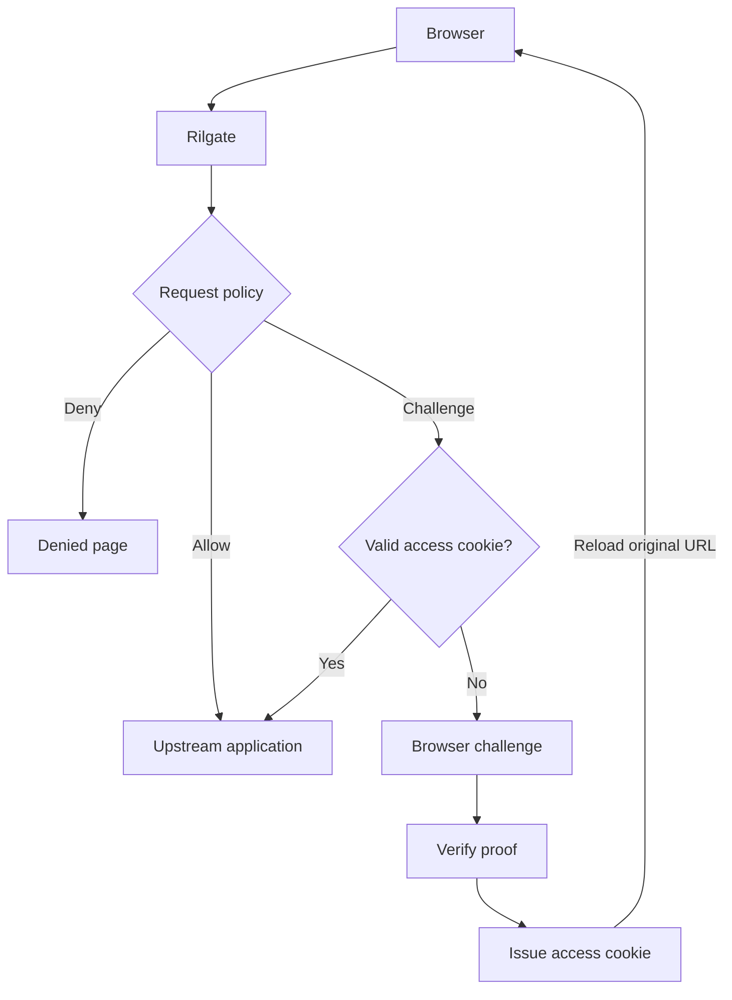

<div align="center">

# Rilgate

[](https://github.com/ViGrise/rilgate/actions/workflows/ci.yml)
[](LICENSE)
[](rust-toolchain.toml)
[](docs/pow.md#randomx-throughput)
[](#project-status)

Rilgate is a reverse proxy gateway that uses proof-of-work challenges. It places a browser
challenge in front of your web application, then forwards requests after the
browser completes the required work.

[Website](https://rilgate.com) · [Quick start](#quick-start) · [Documentation](#documentation) · [Issues](https://github.com/ViGrise/rilgate/issues) · [Contributing](#contributing)

</div>

## Features

- **Two PoW algorithms:** lightweight SHA-256 (`fast`) and memory-intensive RandomX.
- **Request policies:** choose allow, deny, challenge or weight adjustments using
  paths, user agents and headers.
- **Two RandomX modes:** local verification or access granted after P2Pool accepts
  a submitted share. RandomX starts only after explicit browser consent.
- **Shared Rust implementation:** native verification and browser WebAssembly use
  the same RandomX core.
- **Customizable web UI:** templates, branding, translations, cookie names and
  internal paths come from configuration or filesystem overrides.
- **Bounded resources:** proof rate limits, verifier queues, pool sessions, request
  bodies and timeouts. Web resources support atomic reloads.

## Quick start

You need stable Rust through [rustup](https://rustup.rs). The repository toolchain
includes the WebAssembly target. Node.js 24 is needed to run the browser tests;
Python 3 is used only for the demo upstream below.

Clone the repository and build the gateway:

```bash
git clone https://github.com/ViGrise/rilgate.git
cd rilgate
scripts/build.sh
```

In one terminal, start a small upstream site:

```bash
demo_dir="$(mktemp -d)"
mkdir -p "$demo_dir/protected"
printf '%s\n' '<h1>Hello from the upstream</h1>' > "$demo_dir/protected/index.html"
python3 -m http.server 3000 --bind 127.0.0.1 --directory "$demo_dir"
```

In another terminal, copy the example to your configuration file and start Rilgate:

```bash
cp config/rilgate.example.yml config/rilgate.yml
./target/debug/rilgate --config config/rilgate.yml
```

Open **<http://localhost:8080/protected/>**. The browser solves a Fast challenge,
receives an access cookie and reloads the same URL to reach the upstream page.
The example assigns Fast challenges to browser-like User-Agents, so this demo
does not require P2Pool. Policies that select RandomX require a P2Pool endpoint.
Existing `POW_*` and `UPSTREAM_*` environment variables or a local `.env` file
can override the copied configuration.

Check gateway health:

```bash
curl http://localhost:8080/.well-known/rilgate/api/health
```

## How it works



Without a valid access cookie, protected GET/HEAD requests receive challenge
HTML at the requested URL. Other protected methods return `401`, allowing the
client to retry after authentication. Internal APIs and static resources live
under `web.base_path`, which defaults to `/.well-known/rilgate`.

Fast proofs run in a browser worker. RandomX uses roughly 256 MiB for its cache,
plus scratchpads and runtime memory, and requires WebAssembly SIMD128. Both
RandomX modes obtain work from a P2Pool Stratum endpoint.

See [gateway behavior](docs/gateway.md) and [proof of work](docs/pow.md) for
protocol, host binding, lifetime and enforcement details.

## Configuration

Rilgate looks for `config/rilgate.yml` by default. This operator-owned file is
not included in the repository; copy [the full example](config/rilgate.example.yml)
or choose another file with `--config` or `CONFIG`. Settings resolve in this
order: CLI flags, environment variables, YAML, then defaults. Without a default
file, Rilgate uses environment variables and built-in defaults, which allow
requests at the default risk weight.

```yaml
upstream:
  url: http://127.0.0.1:3000
web:
  name: My Gateway
  website_url: https://example.com
  base_path: /.well-known/gate
pow:
  auth_cookie_name: gate_auth
```

Copy the full example when creating a deployment configuration. Production mode
requires strong signing keys and rejects the development placeholders. Public
branding, auth and language cookie names, templates and locales are configurable.

See [configuration](docs/configuration.md), [request policies](docs/policy.md)
and [web resources](docs/web.md) for the complete behavior and examples.

## Deployment

Build a release binary with embedded web assets:

```bash
scripts/build.sh --release
./target/release/rilgate --config /path/to/rilgate.yml
```

Docker and Compose examples are included:

```bash
docker build -f deploy/docker/Dockerfile -t rilgate:local .
cp config/rilgate.example.yml config/rilgate.yml
docker compose -f deploy/docker/compose.yml up --build
```

The Compose example mounts `config/` and expects an upstream application and
P2Pool on the host. The copied example uses development mode; configure
production mode and strong signing keys for a public deployment.
See [deployment examples](deploy/README.md) for configuration, systemd, Caddy
and nginx integration.

## Documentation

| Guide                                     | Contents                                                |
| ----------------------------------------- | ------------------------------------------------------- |
| [Architecture](docs/architecture.md)      | Crate boundaries, dependencies and detailed source tree |
| [Configuration](docs/configuration.md)    | Loading, precedence, scaling and a full example         |
| [Gateway](docs/gateway.md)                | Routing, reverse proxy behavior and resource limits     |
| [Policies](docs/policy.md)                | Matchers, request weights and algorithm selection       |
| [Proof of work](docs/pow.md)              | Fast, RandomX, P2Pool modes and token lifecycle         |
| [Web resources](docs/web.md)              | Branding, templates, translation fallback and reloads   |
| [Adding an algorithm](docs/algorithms.md) | Backend, provider and browser contracts                 |
| [Development](docs/development.md)        | Build, tests and RandomX reference validation           |

## Project status

Rilgate is experimental. Fast and RandomX are implemented; GhostRider and BLAKE3
are potential extensions. HTTP serving and upstream forwarding use Pingora, including
application WebSocket proxying. Distributed rate limiting,
key rotation and metrics exporters are not implemented.

Local proofs and access tokens are reusable within their signed lifetime.
Single-use verification across gateway instances would require shared state or a
different protocol. RandomX solve time depends heavily on the device and
configured difficulty; test the policy against the browsers you intend to serve.

## Contributing

[Bug reports](https://github.com/ViGrise/rilgate/issues), documentation improvements
and [pull requests](https://github.com/ViGrise/rilgate/pulls) are welcome. Include
reproduction steps, the expected and actual behavior, and relevant Rust/browser
versions. Remove secrets from configuration and logs before sharing them.

For code changes, start with the [architecture](docs/architecture.md) and keep
changes within the owning crate. New algorithms follow the
[algorithm guide](docs/algorithms.md). Run the default checks before submitting:

```bash
scripts/test.sh
```

Native RandomX reference tests are opt-in because they allocate a 256 MiB cache.
See [development](docs/development.md) for those commands.

## License

Copyright 2026 [Thinh Hoang](https://www.thinhhv.com) and [ViGrise Technology](https://www.vigrise.com). Licensed under the [Apache License 2.0](LICENSE).
