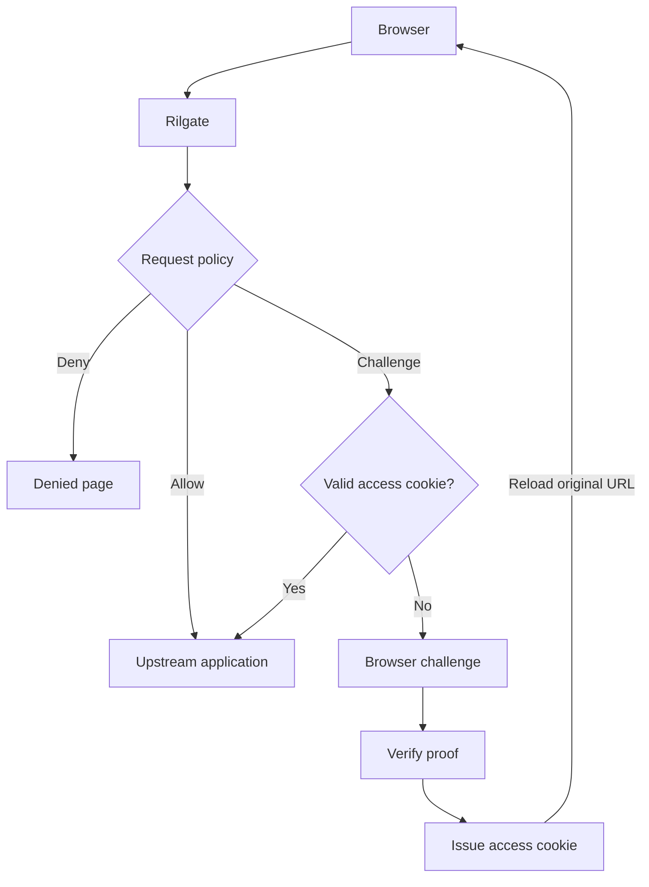

<div align="center">

# Rilgate

[](https://github.com/ViGrise/rilgate/actions/workflows/ci.yml)
[](LICENSE)
[](rust-toolchain.toml)
[](docs/pow.md#randomx-throughput)
[](#project-status)

Rilgate is a reverse proxy gateway that uses proof-of-work challenges. It places a browser
challenge in front of your web application, then forwards requests after the
browser completes the required work.

[Website](https://rilgate.com) · [Installation](#installation) · [Documentation](https://platform.vigrise.com/docs/open-source-software/rilgate/getting-started/introduction) · [Issues](https://github.com/ViGrise/rilgate/issues) · [Contributing](#contributing)

</div>

## Features

- **Four challenge types:** lightweight SHA-256 (`fast`), local CPU work (`hashwx`),
  memory-intensive RandomX (`randomx`) and a delay without JavaScript (`refresh`).
- **Request policies:** allow, deny, challenge or adjust the score of a request.
  Policies match paths, methods, user agents, headers, IP ranges, GeoIP data and
  request rates. The score selects the challenge and its difficulty.
- **Honeypot:** a hidden link on the challenge pages flags crawlers that follow every link.
  A policy rule can then deny or challenge them.
- **Two RandomX modes:** local verification or access granted after a Stratum pool accepts
  a submitted share. Rilgate uses several pools with failover.
- **Customizable web UI:** templates, branding, translations and legal notices come from
  configuration or filesystem overrides.
- **Bounded resources:** proof rate limits, verifier queues, pool sessions, request
  bodies and timeouts.

## How it works



Without a valid access cookie, protected GET and HEAD requests receive challenge HTML at
the requested URL. Other protected methods return `401`. The client can retry
after authentication. Internal APIs and static resources live under `site.base_path`, which
defaults to `/.well-known/rilgate`.

HashWX provides local CPU work with generated WASM and an interpreted verifier.
It needs no pool. Its difficulty defaults await a mid-range phone measurement.
See [the HashWX example](config/examples/hashwx.yml).

Fast proofs run in a browser worker. RandomX uses roughly 256 MiB per worker for its
cache, plus scratchpads and runtime memory. It requires Worker, WebAssembly and BigInt.
SIMD is optional. See [RandomX throughput](docs/pow.md#randomx-throughput). Both RandomX
modes get work from a Stratum pool. See
[when every pool is unavailable](docs/pow.md#when-every-pool-is-unavailable) for the fallback.

See [gateway behavior](docs/gateway.md) and [proof of work](docs/pow.md) for protocol, host
binding, lifetime and enforcement details.

## Installation

Linux, macOS and FreeBSD:

```bash
curl -fsSL https://github.com/ViGrise/rilgate/releases/latest/download/install.sh | bash
```

Windows:

```powershell
irm https://github.com/ViGrise/rilgate/releases/latest/download/install.ps1 | iex
```

Docker:

```bash
docker run -d -p 8080:8080 --add-host=host.docker.internal:host-gateway \
  -e RILGATE_SECURITY_SECRET="$(openssl rand -hex 32)" \
  -e RILGATE_SERVER_UPSTREAM_URL=http://host.docker.internal:3000 \
  ghcr.io/vigrise/rilgate:latest
```

With Docker Compose:

```yaml
# compose.yml
services:
  rilgate:
    container_name: rilgate
    image: ghcr.io/vigrise/rilgate:latest
    restart: unless-stopped
    environment:
      RILGATE_SERVER_UPSTREAM_URL: "http://host.docker.internal:3000"
    ports:
      - "8080:8080"
    extra_hosts:
      - "host.docker.internal:host-gateway"
    read_only: true
    tmpfs:
      - /tmp:size=16m,noexec,nosuid
    logging:
      driver: json-file
      options:
        max-size: "10m"
```

```bash
docker compose up -d
```

Releases also have Debian and RPM packages, systemd system extension images, Windows
installers and a source archive with vendored dependencies. See
[installation](docs/installation.md) for install options, packages, signature checks and
upgrades.

## Configuration

Rilgate reads `rilgate.yml` from the working directory, with a fallback to `config/rilgate.yml`.
Use `--config FILE` or `RILGATE_CONFIG` only for a file elsewhere. Only the upstream URL is
required. Without a signing secret, Rilgate generates a random secret at each start and
reports a `generated-secret` warning. Access cookies then end at restart, and other
instances cannot verify them. For production, set a secret:

```bash
export RILGATE_SECURITY_SECRET="$(openssl rand -hex 32)"
```

The defaults are production, embedded resources, local Fast verification and
`policy: !include builtin:policies/balanced.yml`. HKDF derives independent purpose-specific signing keys. Unknown fields and
conflicting settings fail validation in every environment.

Use `rilgate config check` to validate and `rilgate config show --defaults` to inspect all defaults with secrets
redacted. You can also supply every setting as a flag or `RILGATE_*` variable. See
`rilgate --help`.

See [the default configuration](config/rilgate.yml), [configuration examples](config/examples/),
[built-in policies and rules](docs/policy.md#built-in-policies-and-rules), [configuration](docs/configuration.md),
[request policies](docs/policy.md), [web resources](docs/web.md), and
[production operations](docs/production.md).

## Documentation

The full documentation is published at [platform.vigrise.com](https://platform.vigrise.com/docs/open-source-software/rilgate/getting-started/introduction). The guides in
this repository track the source:

| Guide                                     | Contents                                                |
| ----------------------------------------- | ------------------------------------------------------- |
| [Installation](docs/installation.md)      | Install scripts, packages, Docker, verification and upgrades |
| [Architecture](docs/architecture.md)      | Crate boundaries, dependencies and detailed source tree |
| [Configuration](docs/configuration.md)    | Loading, precedence, scaling and a full example         |
| [Gateway](docs/gateway.md)                | Routing, reverse proxy behavior and resource limits     |
| [Signals](docs/signals.md)                | IP sets, ASN sets, GeoIP, DNS lookups, honeypot and counters |
| [Policies](docs/policy.md)                | Presets, rules, conditions, difficulty escalation and algorithm selection |
| [Proof of work](docs/pow.md)              | Fast, HashWX, refresh, RandomX, Stratum pools, fallback and token lifecycle |
| [Web resources](docs/web.md)              | Branding, page design, legal notices, templates, translations and reloads |
| [AJAX and API integration](docs/api-integration.md) | JSON challenge responses and iframe completion |
| [Adding an algorithm](docs/algorithms.md) | Backend, provider and browser contracts                 |
| [Production operations](docs/production.md) | Deployment hardening, monitoring, rotation and rollback |
| [Development](docs/development.md)        | Build, tests and RandomX reference validation           |
| [Performance](docs/performance.md)        | Asset and gate benchmarks with measurement records      |

## Project status

Rilgate is experimental. Fast, HashWX, refresh and RandomX are implemented. GhostRider and BLAKE3 are
potential extensions.

HTTP serving and upstream forwarding use Pingora, including application WebSocket
proxying. Key rotation, Prometheus metrics and production deployment defaults are
available. Rate limits remain local to each gateway instance. Shared quotas can be
enforced at the edge. See [production operations](docs/production.md) for rollout and validation
requirements.

Local proofs and access tokens are reusable within their signed lifetime. Single-use
verification across gateway instances would need shared state or a different protocol.
RandomX solve time depends heavily on the device and configured difficulty. Test the
policy against the browsers you intend to serve.

## Contributing

[Bug reports](https://github.com/ViGrise/rilgate/issues), documentation improvements and [pull requests](https://github.com/ViGrise/rilgate/pulls) are
welcome. Include reproduction steps, the expected and actual behavior, and relevant Rust
and browser versions. Before you share configuration and logs, remove secrets from them.

For code changes, read the [architecture](docs/architecture.md) first. Keep changes within the
owning crate. New algorithms follow the [algorithm guide](docs/algorithms.md). Before you submit
changes, run the default checks:

```bash
scripts/test.sh
```

Native RandomX reference tests are opt-in because they allocate a 256 MiB cache. See
[development](docs/development.md) for those commands.

## License

Copyright 2026 [Thinh Hoang](https://www.thinhhv.com) and [ViGrise Technology](https://www.vigrise.com). Licensed under the [Apache License 2.0](LICENSE).
