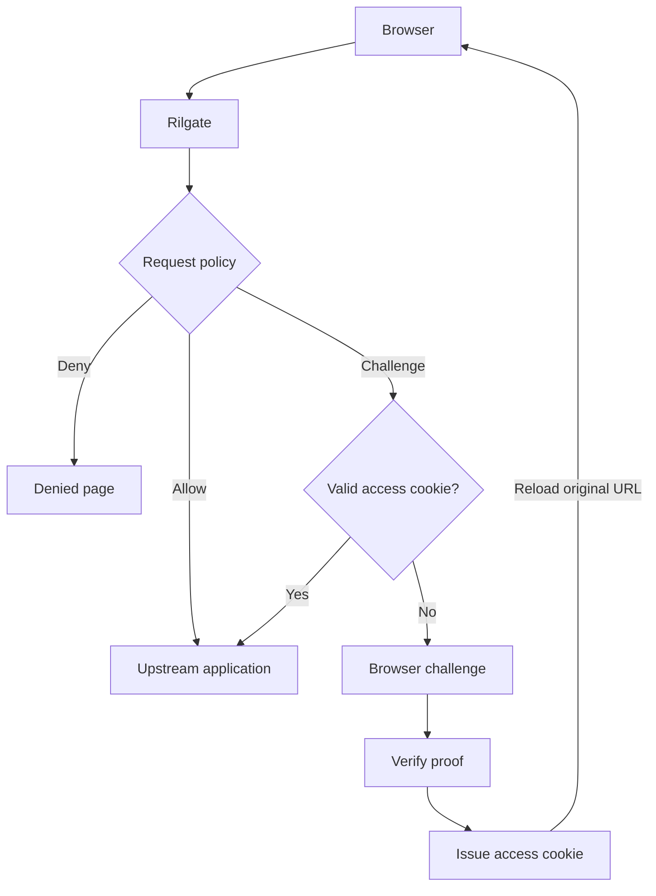

<div align="center">

# Rilgate

[](https://github.com/ViGrise/rilgate/actions/workflows/ci.yml)
[](LICENSE)
[](rust-toolchain.toml)
[](docs/pow.md#randomx-throughput)
[](#project-status)

Rilgate is a reverse proxy gateway that uses proof-of-work challenges. It places a browser
challenge in front of your web application, then forwards requests after the
browser completes the required work.

[Website](https://rilgate.com) · [Quick start](#quick-start) · [Documentation](https://platform.vigrise.com/docs/open-source-software/rilgate/getting-started/introduction) · [Issues](https://github.com/ViGrise/rilgate/issues) · [Contributing](#contributing)

</div>

## Features

- **Two PoW algorithms:** lightweight SHA-256 (`fast`) and memory-intensive
  RandomX.
- **Request policies:** allow, deny, challenge or adjust the score of a request.
  Policies match paths, methods, user agents, headers, client IP ranges and
  published IP sets.
- **Two RandomX modes:** local verification or access granted after Stratum pool accepts a
  submitted share. RandomX starts only after explicit browser consent.
- **Shared Rust implementation:** native verification and browser WebAssembly use the
  same RandomX core.
- **Customizable web UI:** templates, branding, translations, cookie names and internal
  paths come from configuration or filesystem overrides.
- **Bounded resources:** proof rate limits, verifier queues, pool sessions, request
  bodies and timeouts. Web resources support atomic reloads.

## How it works



Without a valid access cookie, protected GET and HEAD requests receive challenge HTML at
the requested URL. Other protected methods return `401`. The client can retry
after authentication. Internal APIs and static resources live under `site.base_path`, which
defaults to `/.well-known/rilgate`.

HashWX provides local CPU work with generated WASM and an interpreted verifier.
It needs no pool. Its difficulty defaults await a mid-range phone measurement.
See [the HashWX example](config/examples/hashwx.yml).

Fast proofs run in a browser worker. RandomX uses roughly 256 MiB for its cache, plus
scratchpads and runtime memory. It requires WebAssembly SIMD128. Both RandomX modes get
work from a Stratum pool Stratum endpoint.

See [gateway behavior](docs/gateway.md) and [proof of work](docs/pow.md) for protocol, host
binding, lifetime and enforcement details.

## Quick start

1. On Linux or macOS, install the latest release:

   ```bash
   curl -fsSL https://github.com/ViGrise/rilgate/releases/latest/download/install.sh | bash
   ```

   Windows archives are on the [releases page](https://github.com/ViGrise/rilgate/releases).

2. Create `rilgate.yml` in the working directory, with your application as the
   upstream. Rilgate reads this file by default:

   ```yaml
   environment: development # allows the access cookie over plain HTTP
   server:
     upstream:
       url: http://127.0.0.1:3000
   security:
     secret: "${RILGATE_SECURITY_SECRET}"
   ```

3. Start the gateway:

   ```bash
   export RILGATE_SECURITY_SECRET="$(openssl rand -hex 32)"
   rilgate
   ```

4. Open <http://localhost:8080>.

See the documentation for [other installation methods](https://platform.vigrise.com/docs/open-source-software/rilgate/getting-started/installation) (Docker, source
builds), [configuration](https://platform.vigrise.com/docs/open-source-software/rilgate/configuration/overview) and [deployment](https://platform.vigrise.com/docs/open-source-software/rilgate/deployment/overview).

## Configuration

Rilgate reads `rilgate.yml` from the working directory, with a fallback to `config/rilgate.yml`.
Use `--config FILE` or `RILGATE_CONFIG` only for a file elsewhere. Only the upstream URL and
signing secret are required, as in the quick start.

The defaults are production, embedded resources, local Fast verification and
`policy.mode: balanced`. HKDF derives independent purpose-specific signing keys. Unknown fields and
conflicting settings fail validation in every environment.

Use `rilgate config check` to validate and `rilgate config show --defaults` to inspect all defaults with secrets
redacted. You can also supply every setting as a flag or `RILGATE_*` variable. See
`rilgate --help`. The schema has no version field and replaces the unreleased previous
format.

See [the default configuration](config/rilgate.yml), [configuration examples](config/examples/),
[built-in policies and rules](docs/policy.md#built-in-policies-and-rules), [configuration](docs/configuration.md),
[request policies](docs/policy.md), [web resources](docs/web.md), and
[production operations](docs/production.md).

## Documentation

The full documentation is published at [platform.vigrise.com](https://platform.vigrise.com/docs/open-source-software/rilgate/getting-started/introduction). The guides in
this repository track the source:

| Guide                                     | Contents                                                |
| ----------------------------------------- | ------------------------------------------------------- |
| [Architecture](docs/architecture.md)      | Crate boundaries, dependencies and detailed source tree |
| [Configuration](docs/configuration.md)    | Loading, precedence, scaling and a full example         |
| [Gateway](docs/gateway.md)                | Routing, reverse proxy behavior and resource limits     |
| [Policies](docs/policy.md)                | Matchers, IP sets, request weights and algorithm selection |
| [Proof of work](docs/pow.md)              | Fast, RandomX, Stratum pool modes and token lifecycle         |
| [Web resources](docs/web.md)              | Branding, templates, translation fallback and reloads   |
| [AJAX and API integration](docs/api-integration.md) | JSON challenge responses and iframe completion |
| [Adding an algorithm](docs/algorithms.md) | Backend, provider and browser contracts                 |
| [Production operations](docs/production.md) | Deployment hardening, monitoring, rotation and rollback |
| [Development](docs/development.md)        | Build, tests and RandomX reference validation           |
| [Performance](docs/performance.md)        | Asset and gate benchmarks with measurement records      |

## Project status

Rilgate is experimental. Fast, HashWX and RandomX are implemented. GhostRider and BLAKE3 are
potential extensions.

HTTP serving and upstream forwarding use Pingora, including application WebSocket
proxying. Key rotation, Prometheus metrics and production deployment defaults are
available. Rate limits remain local to each gateway instance. Shared quotas can be
enforced at the edge. See [production operations](docs/production.md) for rollout and validation
requirements.

Local proofs and access tokens are reusable within their signed lifetime. Single-use
verification across gateway instances would need shared state or a different protocol.
RandomX solve time depends heavily on the device and configured difficulty. Test the
policy against the browsers you intend to serve.

## Contributing

[Bug reports](https://github.com/ViGrise/rilgate/issues), documentation improvements and [pull requests](https://github.com/ViGrise/rilgate/pulls) are
welcome. Include reproduction steps, the expected and actual behavior, and relevant Rust
and browser versions. Before you share configuration and logs, remove secrets from them.

For code changes, read the [architecture](docs/architecture.md) first. Keep changes within the
owning crate. New algorithms follow the [algorithm guide](docs/algorithms.md). Before you submit
changes, run the default checks:

```bash
scripts/test.sh
```

Native RandomX reference tests are opt-in because they allocate a 256 MiB cache. See
[development](docs/development.md) for those commands.

## License

Copyright 2026 [Thinh Hoang](https://www.thinhhv.com) and [ViGrise Technology](https://www.vigrise.com). Licensed under the [Apache License 2.0](LICENSE).
